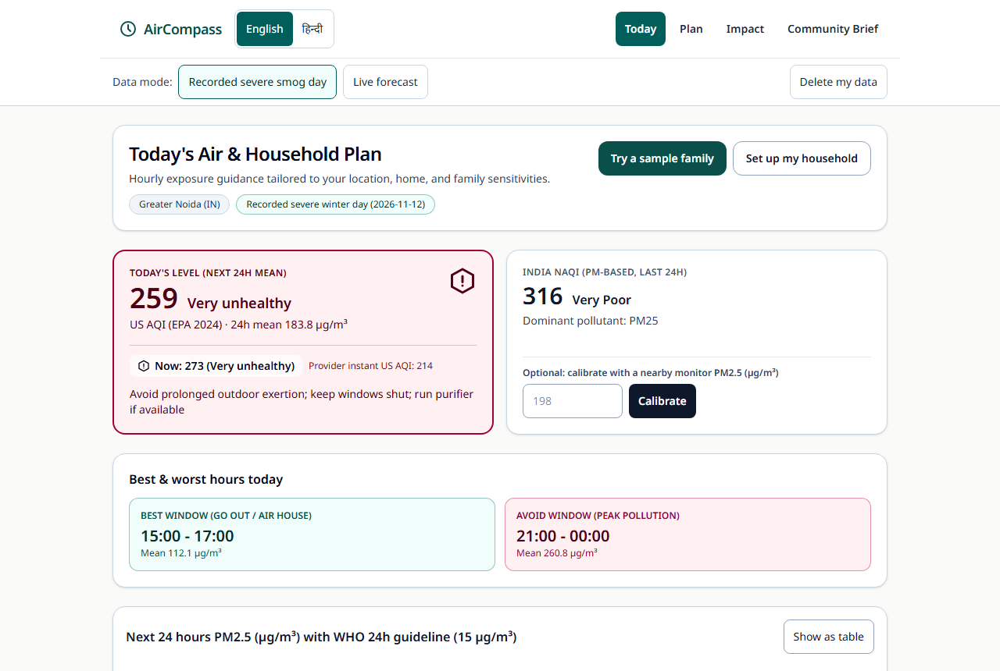

# AirCompass 🌬️

> **GenAI-powered urban air-quality planner for Indian families** — Hack2skill PromptWars Virtual Challenge 06

[](#verification-evidence)
[](#verification-evidence)
[](#verification-evidence)
[](#verification-evidence)
[](#verification-evidence)
[](#accessibility)
[](LICENSE)



---

## 60-Second Judge Path

```bash
git clone https://github.com/farhanmallik05/aircompass
cd aircompass
cp .env.example .env.local          # add your GEMINI_API_KEY (or leave blank for demo mode)
npm ci
npm run verify                       # format → lint (<=300 lines, <=4 params) → strict types → oracle → 161 tests → evals → build
npm run test:e2e                     # 10 Playwright tests incl. 6 CSP gates & WCAG 2.2 AA Axe audit
npm run mutate                       # Stryker mutation score (measured: 91.68%)
```

**No key?** The app works without a `GEMINI_API_KEY` using the labelled recorded Greater Noida severe-day fixture (`2026-11-12`). Clicking **"Try a sample family"** opens the complete Today, Plan, Impact, and Community Brief flow; `/api/plan` degrades to the deterministic engine plan with an `"Engine plan"` badge.

---

## Problem Statement Traceability

> *Create a GenAI-powered assistant that helps families and communities navigate severe winter smog and urban air pollution. Suggest low-emission daily routines, indoor air quality hacks, and sustainable alternatives tailored to their location and lifestyle, while clearly explaining the direct impact of their choices.*

| Requirement | Implementation | Files |
|---|---|---|
| **GenAI-powered** | Gemini Flash (`@google/genai`) generates structured JSON plan selection/wording + grounded streaming chat with `simulate_scenario` tool calling | `src/lib/llm/gemini.ts`, `planner.ts`, `chat.ts` |
| **Families & communities** | Multi-member household setup (adults, children, seniors, respiratory/cardiac/pregnant sensitivities); printable Community & RWA Brief | `src/lib/engine/catalog.ts`, `src/components/SetupForm.tsx`, `BriefView.tsx` |
| **Navigate severe winter smog** | CPCB India NAQI with ≥ 16 h validity gate; Severe-category anchors (flagged assumptions); labelled recorded Greater Noida severe-day fixture | `src/lib/engine/naqi.ts`, `src/lib/providers/demo.ts` |
| **Urban air pollution** | Hourly PM2.5 / PM10 / AQI from Open-Meteo + CAMS global/regional forecast (0.1° cache, 24 h window), plus optional local monitor calibration | `src/lib/providers/openMeteo.ts`, `calibrate.ts` |
| **Daily routines** | 24-hour sub-slot breathing-weighted schedule; commute mode & speed modelling; exercise-window shifting | `src/lib/engine/schedule.ts`, `src/lib/engine/exposure.ts` |
| **Indoor air quality hacks** | First-order hourly mass-balance ODE (penetration, deposition, purifier CADR, window ventilation, cooking source term) | `src/lib/engine/indoor.ts` |
| **Sustainable alternatives** | Annualised CO₂e savings using DEFRA / India GHG factors across commute modes, trip chaining, and no-idling | `src/lib/engine/emissions.ts` |
| **Tailored to lifestyle** | Budget (`zero`/`low`/`medium`), commute distance & days, cooking fuel, window envelope, and household sensitivities feed scoring & eligibility | `src/lib/engine/select.ts` |
| **Direct impact explained** | Exposure delta (µg/m³ & %) with 3-set Conservative/Base/Optimistic uncertainty bounds, Berkeley Earth cigarette-equivalent rule of thumb, 80 % purifier cap, and honest trade-off flags | `src/lib/engine/impact.ts`, `src/lib/engine/sensitivity.ts` |
| **Bilingual EN / HI** | Full EN/HI UI key parity; Hindi prompts; Unicode-normalised output guard with Hindi number-word & medical-claim blocking | `src/lib/client/i18n.ts`, `src/lib/llm/guard.ts` |

---

## GenAI Contribution Map

| Deterministic Engine (`src/lib/engine/`, always runs) | Google Gemini (`src/lib/llm/`, server-side with key) |
|---|---|
| Open-Meteo fetch + Zod validation → PM2.5 / PM10 / US AQI & India NAQI | Structured JSON call (`/api/plan`) selects & orders 5–8 actions from ranked candidates |
| Indoor mass-balance ODE & 24 h breathing-weighted exposure (µg/m³) | Writes household-specific rationale in English or Hindi using `{{token}}` placeholders |
| Conservative / Base / Optimistic uncertainty bounds + CO₂e ranges | Grounded streaming Q&A (`/api/chat`) via `simulate_scenario` function calling |
| Best 2 h go-out window & worst 3 h avoid window | Bilingual Community & RWA Brief wording |
| 26-action eligibility filtering & multi-objective scoring | Retry-once repair loop; falls back cleanly to engine plan if unavailable or guard trips |

**Numbers-by-reference rule:** The LLM never computes or writes raw numerical figures. Prompts supply global and candidate `{{tokens}}`; `guard.ts` rejects any un-tokenised digit, number word, unit, link, markup, medical claim, or canary leak, and `unfaithfulNumbers()` verifies chat responses against engine and tool numbers.

---

## Architecture Overview

```
Browser ──► Next.js 16 App Router (src/app/)
              │
              ├── /api/context   ← geocode + Open-Meteo parallel fetch → AirContext
              ├── /api/plan      ← engine facts + Gemini structured planner → Guard → Rendered Plan
              ├── /api/chat      ← Gemini tool-calling stream → unfaithfulNumbers() check
              └── /api/ping      ← health check
                    │
              src/lib/
              ├── engine/        ← pure TS, zero I/O (bands, naqi, indoor, exposure,
              │                     schedule, sensitivity, impact, select, catalog,
              │                     emissions, window, myths)
              ├── llm/           ← gemini.ts, planner.ts, chat.ts, guard.ts, tokens.ts, fallback.ts
              ├── providers/     ← openMeteo.ts, geocode.ts, demo.ts, calibrate.ts
              └── security/      ← headers.ts, rateLimit.ts, sanitize.ts
```

**Security:** Per-request cryptographic nonce CSP (`src/proxy.ts`) with strict `script-src` (no `unsafe-inline`/`unsafe-eval` scripts); HSTS, `X-Frame-Options: DENY`, `Cross-Origin-Resource-Policy: same-origin`, and strict `/api/*` headers (`next.config.ts`); Zod isolated server-side so client bundles never trigger JIT `eval`; `GEMINI_API_KEY` server-only; bounded hashed-IP rate limiting + daily LLM cap; schema-validated localStorage-only household profiles (one-click `"Delete my data"`).

---

## Verification Evidence

All metrics below were measured locally on this repository (`npm run verify`, `npm run mutate`, `npm run test:e2e`, `npm run measure`, `npm audit`):

| Metric | Measured value | Command |
|---|---|---|
| Unit + integration tests | **161 / 161 pass** (13 files) | `npm run test:coverage` |
| Statement / Line coverage | **99.85 %** (3394 / 3399 across `src/lib/**` + `src/app/api/**`) | `npm run test:coverage` |
| Branch coverage | **96.92 %** (1105 / 1140) | `npm run test:coverage` |
| Function coverage | **100 %** (231 / 231) | `npm run test:coverage` |
| Mutation score (Stryker) | **91.68 %** overall / **91.99 %** covered (engine **91.40 %**, guard **94.57 %** total / **95.31 %** covered) | `npm run mutate` |
| AI persona evals | **12 / 12 pass** (`I1–I12`, demo fixtures) | `npm run eval` |
| E2E Playwright flows | **10 / 10 pass** (3 consecutive runs, 0 flakes) | `npm run test:e2e` |
| CSP & security header gate | **6 / 6 pass** (production build & live Vercel) | `npm run csp:smoke` |
| WCAG 2.2 AA Axe audit | **0 violations** (4 routes × 2 langs × 2 themes + populated states + 320 px reflow) | `npm run test:e2e` |
| Golden oracle integrity | `golden.json matches oracle` | `npm run oracle:check` |
| Production dependency audit | **0 vulnerabilities** (`--omit=dev --audit-level=high`) | `npm audit --omit=dev --audit-level=high` |
| Engine p50 / p95 latency | **1.70 ms / 2.82 ms** (200 runs) | `npm run measure` |
| Gzipped `.next/static` JS | **231.6 KB** (no chart library, self-hosted fonts) | `npm run measure` |
| Tracked repository size | **2.76 MB** (`< 10 MB` limit) | `node scripts/check-repo-size.mjs` |
| Secrets in built bundle | **0** | `npm run test:coverage` |

---

## Running the App

### Local (with Gemini)

```bash
cp .env.example .env.local
# Edit .env.local:
#   GEMINI_API_KEY=<your key>
#   GEMINI_MODEL=gemini-3.6-flash
#   GEMINI_MODEL_FALLBACK=gemini-3.5-flash
npm ci
npm run dev      # → http://localhost:3000
```

### Local (demo mode — no key needed)

```bash
npm ci
npm run dev      # leave GEMINI_API_KEY unset
```

The app serves the labelled recorded Greater Noida severe-day fixture (`2026-11-12`) and uses the deterministic engine fallback plan whenever `GEMINI_API_KEY` is unset or an upstream quota/network error occurs.

### Production build

```bash
npm run build
npm run start    # → http://localhost:3000
```

### Environment Variables

| Variable | Required | Default | Description |
|---|---|---|---|
| `GEMINI_API_KEY` | No | — | Google Generative AI key (server-only); leave unset for engine fallback mode |
| `GEMINI_MODEL` | No | `gemini-3.6-flash` | Primary Gemini model |
| `GEMINI_MODEL_FALLBACK` | No | `gemini-3.5-flash` | Fallback Gemini model |
| `DAILY_LLM_CAP` | No | `200` | Global daily LLM cap per server instance |
| `DAILY_IP_LLM_CAP` | No | `20` | Per-IP daily LLM cap per server instance before engine fallback |
| `NEXT_PUBLIC_DEMO_MODE` | No | `false` | Optional flag to default to demo mode |

---

## Test Suite

```bash
npm run verify          # lint + typecheck + oracle:check + test:coverage + eval + build
npm run test:e2e        # 10 Playwright tests on port 3217 (CSP + flows + WCAG 2.2 AA Axe)
npm run csp:smoke       # 6-check CSP/hydration/header gate on production build
npm run eval            # 12-persona invariant evaluation (offline fixtures)
npm run eval:live       # re-record eval fixtures against live Gemini API
npm run mutate          # Stryker mutation testing (target ≥ 85 %; measured 91.68 %)
npm run oracle:check    # verify golden.json has not been hand-edited
```

| File | Tests | What it covers |
|---|---|---|
| `tests/unit/engine-coverage.test.ts` | 14 | Behavioural + boundary tests across all 26 actions, NAQI, windows, sensitivity, impact, select |
| `tests/unit/mutation-killers.test.ts` | 61 | Targeted Stryker survivor kills wave 1 (guard, select, schedule, exposure, window, impact, catalog) |
| `tests/unit/mutation-killers-2.test.ts` | 32 | Targeted Stryker survivor kills wave 2 (select scoring/picks/trade-off, schedule commute bounds) |
| `tests/unit/gemini-client.test.ts` | 4 | Gemini client config, fallback model handling, retry behavior |
| `tests/unit/providers-and-client.test.ts` | 8 | Geocoding, cache hits, allow-list, calibration, client fetchers, `localStorage`, SSE chat helpers |
| `tests/unit/tools-and-fallback.test.ts` | 4 | `simulate_scenario` tool & deterministic fallback planner wording |
| `tests/unit/i18n-parity.test.ts` | 2 | EN/HI key, placeholder, and Latin-digit parity |
| `tests/security/guard.test.ts` | 10 | Adversarial + benign bypass corpus (`Object.hasOwn()` prototype safety), rule attribution, `findChatSafetyIssue`, Hindi normalisation, numeric faithfulness |
| `tests/security/api-security.test.ts` | 4 | Request validation, streaming 8 KB body cap, trusted-proxy IP rate limiting, per-IP quota, injection isolation |
| `tests/security/bundle-secrets.test.ts` | 2 | Verifies `GEMINI_API_KEY` / prompt canary never leak to client bundles |
| `tests/property/invariants.test.ts` | 3 | `fast-check` properties: AQI/NAQI monotonicity, bounded exposure, severe ordering |
| `tests/golden/golden.test.ts` | 13 | Oracle-backed golden vectors: EPA AQI, CPCB NAQI, indoor ODE, windows, CO₂e |
| `tests/api/routes.test.ts` | 4 | API contracts for `/api/{ping,context,plan,chat}` + fallback resilience |

---

## Engine Reference

- **Air quality standards:** US EPA 2024 PM2.5 AQI breakpoints (40 CFR Part 58 App. G); CPCB India NAQI PM2.5/PM10 sub-indices with ≥ 16 h trailing valid-hour gate.
- **Indoor physics (`dC/dt = a·P·Cout − (a + k + q)·C + S`):** Hourly analytical step + 24 h cyclic settle modeling air exchange `a`, penetration `P`, deposition `k`, purifier equivalent ACH `q`, and cooking source `S` across Conservative / Base / Optimistic parameter sets.
- **CO₂e calculations:** DEFRA UK GHG Conversion Factors & India-specific emission factors for annualised round-trip commute swaps. See `docs/METHODOLOGY.md` for full sources, assumptions, and worked numerical example.

---

## Accessibility

AirCompass targets **WCAG 2.2 Level AA** (`docs/ACCESSIBILITY.md`):

- High contrast (`> 4.5:1`) in both light and dark modes (verified by Axe after fixing `dark:bg-teal-300 dark:text-slate-950`).
- Skip-to-main-content link, `<h1>` focus management across route transitions, and full keyboard navigation.
- Zero horizontal overflow at `320 px` mobile width.
- Bilingual `lang="en"` / `lang="hi"` switching with self-hosted Noto Sans & Noto Sans Devanagari fonts.

---

## Honest Limitations

| Area | Limitation |
|---|---|
| **Grid resolution** | Open-Meteo outside Europe relies on CAMS global forecast (~25–45 km, 3-hourly interpolated), which can smooth street-level smog peaks; mitigated via optional local monitor calibration. |
| **Indoor model** | Single-zone well-mixed room model (`docs/ADR/0003-single-zone-home-model.md`); inter-room airflow is not simulated. |
| **NAQI Severe anchors** | CPCB specifies Severe as `250+` µg/m³; upper linear interpolation anchors (`380` / `510`) are documented assumptions (`assumptionUsed: true`). |
| **Hindi number-word list** | `data/number-words.hi.json` covers common Hindi number words and compound markers, not an exhaustive inflection dictionary. |
| **Rate limiting & LLM quota** | Rate limits and daily caps are in-memory per server instance; free-tier Gemini API keys enforce a 20 req/day cap per model before degrading to engine fallback plans. |

---

## Data Attribution

- **"Air quality data by Open-Meteo.com, CAMS ENSEMBLE data provider" (CC BY 4.0)** — Open-Meteo Air Quality, Weather, and Geocoding APIs.
- **Breathing rates:** US EPA Exposure Factors Handbook, Chapter 6.
- **AQI / NAQI standards:** US EPA 2024 PM2.5 Technical Assistance Document; India CPCB NAQI (2014).
- **CO₂e factors:** DEFRA GHG Conversion Factors & India GHG Platform.

---

## Built With

- **[Next.js 16 (16.4.6)](https://nextjs.org/)** — App Router, React 19, per-request nonce CSP middleware (`src/proxy.ts`)
- **[Google Gemini](https://ai.google.dev/)** (`@google/genai`) — Structured planner & grounded tool-calling chat
- **[Open-Meteo](https://open-meteo.com/)** — Hourly air quality, weather, and geocoding APIs
- **[Tailwind CSS v4](https://tailwindcss.com/)** — Accessible utility styling + dark mode
- **[Vitest](https://vitest.dev/)** + **[fast-check](https://fast-check.dev/)** + **[Stryker](https://stryker-mutator.io/)** — Unit, property, security, and mutation testing
- **[Playwright](https://playwright.dev/)** + **[@axe-core/playwright](https://github.com/dequelabs/axe-core-npm)** — E2E, CSP, and WCAG 2.2 AA verification
- **[Zod v4](https://zod.dev/)** — Server-side schema validation
- **Google Antigravity** — AI engineering environment used to design, build, and verify the submission

---

## License

[MIT](LICENSE) © 2026 Farhan Mallik
